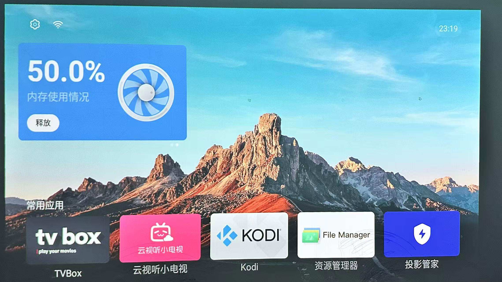

# XGIMI Clean — de-bloat & root toolkit for XGIMI GMUI projectors

[English](README.md) | [简体中文](README.zh-CN.md)

> **Tested on:** XGIMI **NEW Z6X** (IRONMAN / XK03U, MediaTek m7221, GMUI 6.9.102.01, Android 8.0)
> **Likely compatible:** other GMUI-era machines of the same generation (Z6X Pro / Z7X / H series) — not individually verified
> **Principles:** no system-partition changes, no flashing, **every step reversible**; the latest stock firmware and UI stay

<p align="center"></p>

---

## What this is

China-market XGIMI projectors run **GMUI**, which ships a full advertising and telemetry stack: an ad
service, ambient-wallpaper ads, screensaver ads, pop-up promotions, and behavioural reporting. On top
of that, recent firmware removed the user-facing ADB switch, and the system has no developer-options
menu at all — so the usual "connect ADB and disable stuff" route is closed.

This toolkit provides a **pure LAN / USB-stick route**:

1. Re-use the vendor's own after-sales SSH mechanism (`xgimi_ssh`) to run commands as **root**
2. Write in your own ADB key, so `adb connect` works from then on
3. Remove the ad components with `pm uninstall --user 0` (reversible at any time)
4. Back up every firmware partition, so the device can always be fully restored

```
Put a terminal app on a USB stick (10 seconds)
        │
        ▼
write /data/ssh/authorized_keys + setprop      ← g script
        │
        ▼
xgimi_ssh.sh (root) starts sshd                ← the vendor's own service logic
        │
        ▼
params + ProxyCommand = root maintenance cmd   ← p2/p3 helper scripts
        │
        ▼
ADB authorised ✓ → pm uninstall the ad suite ✓ → full firmware backup ✓
```

The full technical documentation (in Simplified Chinese, English summaries at the top of each file)
lives in [`docs/`](docs/): device survey, firmware unpacking, the root mechanism, the de-bloat list,
backup & restore.

## Repository layout

```
docs/        full technical docs (Chinese, with English abstracts)
tools/       firmware parsing, port scanning helpers
scripts/     g / p2 / p3 / p4 generators (make_scripts.py builds them with YOUR keys inside)
post/        debloat / backup / restore scripts + ad-domain blocklist
third_party/ the two sideload APKs (TermOne Plus, GPL-3.0; Z7X-ADB opener, MIT)
```

## Quick start

### 0. Prepare
- A computer on the same LAN as the projector (Python 3 + `adb`)
- A USB stick
- Both APKs are in [`third_party/`](third_party/):
  - **TermOne Plus** (GPL-3.0) — terminal emulator, needs no network setup
  - **Z7X-ADB opener** (MIT) — makes adbd listen on 5555

### 1. Generate your personal maintenance scripts
```bash
python scripts/make_scripts.py
# generates an SSH keypair (if none) and produces scripts/out/{g,p2,p3,p4}
# plus scripts/out/serve/ holding every file the projector will pull
```

### 2. Serve them over HTTP
```bash
cd scripts/out/serve
python -m http.server 8000 --bind 0.0.0.0   # note your PC's IP, called <PC_IP> below
```

### 3. Sideload & open TermOne Plus on the projector (USB stick)

### 4. Enable network ADB (Z7X-ADB opener)
Install and run `third_party/Z7X-ADB-v1.1.0.apk` once. It sets
`persist.adb.tcp.port=5555` etc., so adbd listens on 5555.
`adb connect <IP>:5555` will show `unauthorized` at this point — expected; next step fixes it.

### 5. Complete the root authorisation (inside TermOne)
```sh
busybox wget -O g http://<PC_IP>:8000/g;sh g   # start the vendor root sshd
busybox wget -O p2 http://<PC_IP>:8000/p2;sh p2  # run maintenance script as root
busybox wget -O p3 http://<PC_IP>:8000/p3;sh p3  # ADB key + make block devices readable
```
After `p3 done`, on the computer:
```bash
adb connect <projector IP>:5555     # now shows "device" (authorised)
```

### 6. De-bloat
```bash
bash post/debloat.sh <projector IP>:5555     # remove ad components + disable OTA
bash post/backup_fw.sh <projector IP>:5555   # full firmware backup (strongly recommended first)
```

### 7. (Recommended) permanent root trigger
```sh
busybox wget -O p4 http://<PC_IP>:8000/p4;sh p4   # in TermOne
```
Afterwards, any time: `adb shell "echo 'your command' > /data/local/tmp/rc.sh; setprop pc.root.go 1"`
runs it as root.

## What gets removed

| Package | Purpose | Action |
|---|---|---|
| `com.xgimi.adservice` | ad service core | uninstall |
| `com.xgimi.atmosphere` | ambient / music-wall ads | uninstall |
| `com.xgimi.screensaver` | screensaver ads | uninstall |
| `com.xgimi.datareporter` | behavioural telemetry | uninstall |
| `com.xgimi.activitypage` | pop-up promotions | uninstall |
| `com.xgimi.upgrade` | system updater (blocks OTA re-installing ads) | disable (reversible) |

All removals are `--user 0` level; restore with `post/restore.sh` (one command, or per package).

**Optional extra:** swap in a third-party launcher for an ad-free home (tested with EMOTN UI,
`com.oversea.aslauncher`), and switch back to the stock GMUI launcher at any time —
see [docs/04-debloat.md](docs/04-debloat.md) or `bash post/restore.sh <IP>:5555 home`.

**Hardware services you must NOT touch** — keystone correction, ToF autofocus, the HDMI input
player, the MStar input/hotkey stack, remote pairing — are documented in
[docs/04-debloat.md](docs/04-debloat.md), cross-checked against the overseas XGIMI DO-NOT-DISABLE
lists of the [cleanyourtv](https://github.com/Gathin23/cleanyourtv) project.

## How the root mechanism works (short version)

- GMUI firmware ships a vendor after-sales service: `service xgimi_ssh` (init.xgimi.rc, **root**,
  oneshot) runs `/vendor/bin/xgimi_ssh.sh`. When the property `xgimi.remoteDebug.on` is `true`, it
  starts a root sshd and executes `/system/bin/ssh $(cat /data/ssh/params)`.
- `/data/ssh` is mode **0777**, so any app can write `params`;
  `params = -oProxyCommand=/data/ssh/p 127.0.0.1` makes the root ssh client execute a maintenance
  script prepared by the device owner **before** connecting → maintenance commands run as root.
- ADB authorisation: root appends your public key to `/data/misc/adb/adb_keys`.
- On the original firmware, USB/network ADB was itself an after-sales channel
  (`vendor/build.prop` contains `persist.adb.tcp.port=5555`); recent builds only removed the
  user-facing switch.

## FAQ

**Why does ADB still say `unauthorized` after the Z7X-ADB opener ran?**
The opener only makes adbd listen. This unit's adbd runs in secure mode (`ro.adb.secure=1`): your
public key must be written to `/data/misc/adb/adb_keys`, GMUI shows no authorisation dialog, and
that file is root-only. The g/p2 scripts use the `xgimi_ssh` root service to write your key in —
opening the door from the inside. Details in [docs/06-faq.md](docs/06-faq.md).

## Legal & disclaimer

- Every capability in this project comes from debugging/after-sales interfaces the vendor itself
  **pre-installed and reserved** in the firmware (the `xgimi_ssh` service, debug properties, the
  engineering menu). This project contains, and provides, no code that bypasses the vendor's
  security design; all operations happen with the **device owner's own authorisation**.
- For **your own devices** only. Operating someone else's device without the owner's consent may
  violate applicable law.
- Removing pre-installed components may violate the vendor's terms of service and may affect
  warranty — evaluate for yourself.
- Run `post/backup_fw.sh` for a full backup before any system-level operation.
- Every `pm uninstall --user 0` can be undone with `cmd package install-existing`; re-enable
  `com.xgimi.upgrade` (`pm enable`) before accepting an OTA update.
- Do not use this project for piracy or circumventing paid services.

## Credits

- [code-ant/z7x-adb](https://github.com/code-ant/z7x-adb) — the ADB-property idea and the opener APK
- [TermOne Plus](https://f-droid.org/en/packages/com.termoneplus/) (F-Droid)
- Everyone who tinkered with XGIMI devices on the ZNDS / TouYing forums before this

## License

MIT
